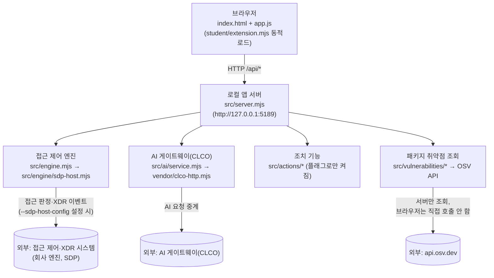

# 학생용 실행 설명서 (STUDENT_RUNBOOK)

21단계 과제 결과물입니다. 다른 사람이 이 설명서만 보고 프로젝트를 실행하고, 무엇이 제공 코드이고 무엇이 학생이 만든 코드인지 구분할 수 있게 쓰였습니다. `docs/GETTING_STARTED_STUDENT.md`(커리큘럼 개요)와 `docs/STUDENT_LAUNCH_GUIDE.md`(실행 도구 세부 옵션)를 대체하지 않고, 이 문서는 실행 절차·구성도·학생 코드 경계·장애 대응을 한 곳에 모은 것입니다.

이 문서의 각 항목은 "실행해서 확인함"과 "코드를 읽고 판단함(추론, 실제 실행 안 함)"을 구분해서 적습니다. 실행 안 한 걸 실행했다고 쓰지 않습니다.

## 1. 필요 프로그램과 확인한 버전

이 저장소를 작업한 PC에서 실제로 실행해 확인한 버전입니다(실행함):

```
$ node -v
v24.21.0
$ npm -v
11.19.0
$ git --version
git version 2.55.0.windows.3
```

- `on-client/package.json`의 `engines.node`는 `"24.19.0"`(정확한 고정값)입니다. 실제 설치 버전(`v24.21.0`)과 **패치 버전이 다릅니다.** 메이저 버전(24)은 같습니다.
- 제공 실행 도구(`tools/start-alekov.ps1`)는 Node.js 22~24 범위를 허용하고, 정확히 24.19.0이 아니면 "참고: 지금 Node.js 는 vXX.XX.X 입니다. 수업 기준은 v24.19.0 입니다."라는 안내만 출력한 뒤 **계속 진행합니다**(차단하지 않음, `tools/start-alekov.ps1:92-93` 코드 확인).
- `npm`을 직접 쓰는 경로(`npm run check` 등)에는 버전 검사 자체가 없습니다(코드 확인, `package.json`·`src/server.mjs`에 버전 검사 없음).
- `on-client`는 외부 npm 패키지 의존성이 없습니다(`package.json`에 `dependencies` 없음). **`npm install`이 필요하지 않습니다.**

## 2. 폴더 구조

```
on-client/
├─ .env.example        예시 설정(비밀 없음)
├─ .on-starter-manifest.json   제공 파일의 해시 목록
├─ README.md
├─ package.json         scripts: start / demo / check
├─ docs/                과제 안내·운영 문서 12개
├─ public/               브라우저 쪽 코드
│  ├─ index.html
│  ├─ app.js             제공 화면 로직, 학생 함수 호출
│  ├─ ai-connect.mjs      계정/AI 연결 화면
│  └─ vulnerabilities-view.mjs
├─ src/                  로컬 서버(Node.js)
│  ├─ server.mjs          라우팅 전체
│  ├─ engine.mjs          접근 제어 엔진 로더
│  ├─ engine/             SDP(접근 제어·XDR) 연동 — 설정 시에만 사용
│  ├─ ai/                 AI 게이트웨이(CLCO) 연동
│  ├─ connection/         계정·AI 앱 승인 흐름
│  ├─ actions/            조치(집행) 기능 — 플래그 켤 때만 활성화
│  └─ vulnerabilities/    OSV 취약점 조회(20단계)
├─ student/
│  ├─ extension.mjs       **학생이 수정하는 유일한 파일**
│  └─ engine-adapter.mjs  제공 원본(학생이 고치지 않음, 8절 참고)
├─ vendor/
│  └─ clco-http.mjs       AI 게이트웨이 전송 클라이언트(제공)
└─ tools/
   └─ start-alekov.ps1    제공 PowerShell 실행 도구
```

## 3. PowerShell을 여는 위치

두 가지 다 됩니다(실행해 확인함, `npm --prefix on-client run check`를 저장소 루트와 `on-client` 양쪽에서 각각 실행해 둘 다 `exit 0`을 확인):

- 저장소 루트에서: `npm --prefix on-client run <스크립트>`
- `on-client` 폴더 안에서: `npm run <스크립트>`

단, 제공 PowerShell 스크립트(`tools\start-alekov.ps1`)는 상대 경로를 기준으로 동작하므로, **이 스크립트를 쓸 때는 `on-client` 폴더 안에서** PowerShell을 열어야 합니다.

## 4. 실행 명령

| 명령 | 동작 |
|---|---|
| `npm --prefix on-client run demo` | 예제 데이터로 화면을 보여줌. 실제 연결이 아님. |
| `npm --prefix on-client start` | 실제 연결 모드로 서버 기동(기본은 접근 제어 엔진이 연결 안 된 `disconnected` 상태) |
| `npm --prefix on-client run check` | `student/extension.mjs`의 **문법만** 검사(`node --check`) |
| `powershell -NoProfile -ExecutionPolicy Bypass -File .\tools\start-alekov.ps1` (on-client 폴더 안에서) | 제공 실행 도구 — Node 버전 확인, 포트 충돌 사전 검사, 서버 응답 확인까지 자동으로 해줌 |

`npm run demo`는 이 세션에서 **실제로 실행하고 브라우저로 접속해 화면까지 확인했습니다**(17~18단계 작업 중). 아래 5절의 시작 메시지와 주소가 실제로 뜨는 것을 직접 봤습니다.

## 5. 브라우저 주소와 "정상 시작됐다"는 신호

- 기본 주소: `http://127.0.0.1:5189/`
- 기본 포트는 5189이며, 환경변수 `ON_PORT`로 바꿀 수 있습니다(`src/server.mjs:726`).
- 서버가 포트 바인딩에 성공하면 콘솔에 아래 메시지가 뜹니다(`src/server.mjs:744` 코드 확인, `npm run demo`로 실제로도 확인함):
  - `npm run demo` → `케셰브 예제: http://127.0.0.1:5189`
  - `npm start` → `케셰브 연결 확인: http://127.0.0.1:5189`
- **주소 형식에 주의**: 서버는 `Host` 헤더가 정확히 `127.0.0.1:<포트>` 또는 `localhost:<포트>`가 아니면 403(`HOST_REJECTED`)으로 거부합니다. 주소에 `?`로 시작하는 쿼리스트링을 붙이면 400(`QUERY_REJECTED`)으로 거부됩니다(`src/server.mjs:355-359` 코드 확인). 주소창에 깨끗한 `http://127.0.0.1:5189/`만 입력해야 합니다.

## 6. 종료와 재실행

- 포그라운드로 띄운 경우: 그 PowerShell 창에서 `Ctrl+C`.
- **코드로 확인한 사실**: `on-client` 코드 전체에 `SIGINT`/`SIGTERM` 핸들러가 없습니다. 즉 `Ctrl+C`는 Node.js 프로세스를 그냥 종료시킬 뿐, 서버 쪽에 별도의 "정리(cleanup)" 로직이 실행되는 경로가 없습니다(서버 종료 시 연결 정리 코드는 `src/server.mjs`에 있지만, 이걸 호출하는 지점이 코드에 없어 정상 실행 중에는 동작하지 않습니다).
- 재실행: 같은 명령을 다시 실행하면 됩니다. 별도 캐시/상태 파일이 없어 그냥 다시 켜면 됩니다.
- 제공 실행 도구(`start-alekov.ps1`)를 쓰면 포트 충돌을 미리 검사해서 "포트 5189 를 다른 프로그램이 쓰고 있습니다 ... 예: -Port 5190"처럼 안내해 줍니다. `npm run demo`/`npm start`를 직접 쓰면 이 사전 검사가 없습니다.

## 7. 구성도 — 브라우저 → 로컬 앱 서버 → 접근 제어·XDR 시스템 / AI 게이트웨이

### Mermaid



### 글로 쓴 구성도 (그림을 못 보는 경우용)

1. **브라우저**: `public/index.html`이 `public/app.js`를 불러오고, `app.js`가 `student/extension.mjs`(학생 코드)를 동적으로 불러와 화면 일부를 그립니다.
2. **로컬 앱 서버**(`src/server.mjs`, `http://127.0.0.1:5189`): 브라우저의 모든 요청(`/api/me`, `/api/events`, `/api/vulnerabilities`, `/api/ai/check`, `/api/ai/explain`, `/api/actions/*`, `/api/ai/connect/*`, `/api/native-login/*` 등)을 받는 유일한 창구입니다. 브라우저는 서버 바깥(접근 제어 엔진, AI 게이트웨이, OSV)과 직접 통신하지 않습니다.
3. **접근 제어·XDR 시스템**: `src/engine.mjs`가 기본값이며, 설정이 없으면 "연결 안 됨(disconnected)" 상태입니다. 운영자가 `--sdp-host-config`를 켜면 `student/engine-adapter.mjs`(제공 원본)를 거쳐 `src/engine/sdp-host.mjs`가 실제 회사 접근 제어 시스템(SDP)에 접근 판정·XDR 이벤트를 조회합니다.
4. **AI 게이트웨이(CLCO)**: `src/ai/service.mjs`가 `src/ai/app-authorization.mjs`로 앱 권한을 확인한 뒤, `vendor/clco-http.mjs`를 통해 AI 요청을 중계합니다. 17단계에서 다룬 "권한 준비 중(`ON_AI_PROVISIONING_PENDING`)"은 이 경로의 설정이 아직 안 끝났을 때 기본으로 나오는 정상 상태입니다.
5. **조치 기능**(`src/actions/*`, 19단계): 운영자가 `--alekov-actions`와 관련 설정을 함께 켤 때만 동작합니다. 기본적으로는 꺼져 있습니다.
6. **패키지 취약점 조회**(`src/vulnerabilities/*`, 20단계): 서버가 `package-lock.json`과 허용된 패키지 이름만 OSV(`https://api.osv.dev/v1/querybatch`)에 조회합니다. **브라우저는 OSV를 직접 호출하지 않습니다** — 전부 서버를 거칩니다.

## 8. 제공 코드 vs 학생 작성 코드 경계

- `.on-starter-manifest.json`에 기록된 원본 파일 56개의 SHA-256 해시를 작업 트리 파일과 대조했습니다(실행해 확인함): **56개 중 55개가 원본과 완전히 일치**했고, **일치하지 않은 1개가 `student/extension.mjs`였습니다.**
- 즉 이 프로젝트에서 **학생이 실제로 수정한 파일은 `student/extension.mjs` 하나뿐**입니다.
- `student/engine-adapter.mjs`는 `student/` 폴더 안에 있지만, 해시가 원본과 일치합니다 — **학생이 만든 파일이 아니라 제공된 원본 그대로**입니다. 폴더 위치만 보고 "학생 파일"로 착각하면 안 됩니다.
- 제공 서버(`public/app.js`, `src/` 전체)와 판정 코드는 손대지 않았습니다.

### 13~20단계에서 구현한 함수 (전부 `student/extension.mjs` 안)

| 단계 | 함수 | 구현 범위 |
|---|---|---|
| 13 | `renderIdentity` | 로그인 사용자·기기·세션 상태 표시 |
| 14 | `renderDecision` | 업무 앱 접속 판정(allow/deny/challenge/unknown) 표시 |
| 15 | `renderEvents` | 접속 기록·XDR 경보 목록, 필터, 상세 보기 |
| 16 | `renderStatus` | 알림·기기·세션·진단정보·미지원 조치 안내 |
| 17 | `renderAiConnection`, `renderExplanation`(기초) | AI 연결 점검(idle/loading/ok/error, 21개 오류 코드 분류)과 사건 설명 실행을 구분 |
| 18 | `renderExplanation`(완성) | AI 설명을 근거 ID로 현재 이벤트와 대조, 불일치 시 전체 거부 |
| 19 | `renderAction` | AI 제안(prepared)과 실제 서버 처리(executing/pending/succeeded 등) 구분, `succeeded`도 `observation.effectApplied===true`일 때만 효과 확인으로 인정 |
| 20 | `renderVulnerabilities` | 정확한 설치 버전과 OSV 조회 상태(`complete`/`partial`/`not_checked`/`not_configured`/`unverifiable`) 구분 |

각 단계의 상세 구현 내용, 실제로 실행해서 확인한 결과, 확인하지 못한 항목은 `docs/STAGE_LOG.md`(저장소 루트)에 단계별로 기록되어 있습니다. 이 문서는 그 요약입니다 — 세부 내용이 궁금하면 `STAGE_LOG.md`를 보는 게 정확합니다.

## 9. 오류·장애 상황과 확인·복구 방법

아래는 전부 코드를 읽고 근거를 확인한 내용입니다(일부는 이 세션에서 실제로 겪어 확인했고, 일부는 코드 읽기로만 확인했습니다 — 표에 구분 표시):

| 증상 | 원인 | 확인 방법 | 복구 |
|---|---|---|---|
| "포트 5189 를 다른 프로그램이 쓰고 있습니다" | 다른 프로세스가 이미 5189 포트 사용 중 | `start-alekov.ps1`이 사전 검사해서 알려줌 (코드 확인, 실행 안 함) | `-Port 5190`처럼 다른 포트로 실행, 브라우저 주소도 같이 바꿈 |
| "지금 Node.js 는 vX.X.X 입니다. 수업 기준은 v24.19.0 입니다" | Node 버전이 22~24 범위 안이지만 정확히 24.19.0은 아님 | 안내만 뜨고 계속 진행됨(코드 확인) | 그대로 진행해도 됨. 22~24 범위 밖이면 도구가 중단함 |
| "앱 서버가 20 초 안에 뜨지 않았습니다" | 서버 기동 실패 또는 지연 | `start-alekov.ps1`이 20초(조정 가능) 폴링 후 타임아웃 (코드 확인, 실행 안 함) | 콘솔 메시지를 그대로 담당자에게 전달 |
| AI 연결에서 "학생 앱 이용 권한의 발급·연결을 준비 중입니다" (`ON_AI_PROVISIONING_PENDING`) | **기본 상태가 원래 이것입니다** — AI 게이트웨이 설정(`ON_AI_BASE_URL`/`ON_AI_APP_KEY`)이 아직 운영자 쪽에서 안 끝남 | 17단계에서 실제로 데모 서버 띄우고 버튼 눌러서 직접 확인함(실행함) | 학생이 해결할 수 없음 — 운영자에게 계정 연결·앱 권한 확인 요청(17단계 안내와 동일) |
| 주소창에 쿼리스트링을 붙이거나(`?...`), `127.0.0.1`/`localhost` 외의 호스트명으로 접속 | 서버가 `Host` 헤더를 엄격히 검증(403/400) | 코드 확인(`src/server.mjs:355-359`), 실행 안 함 | 주소창에 깨끗한 `http://127.0.0.1:5189/`만 입력 |
| 20단계 취약점 조회가 계속 `not_configured`/`not_checked`로 나옴 | `ON_PROJECT_DIRECTORY`(프로젝트 경로)·`ON_APPROVED_PUBLIC_PACKAGES`(허용 패키지 목록) 환경변수가 운영자 쪽에서 아직 설정 안 됨 | 20단계 작업 중 코드로 확인함 | 학생이 임의로 설정하지 않음(과제 안내와 동일) — 운영자 설정 대기 |

## 10. 지원하지 않거나 확인하지 못한 것 (지어내지 않음)

- 포트 충돌·Node 버전 범위 밖·20초 타임아웃 시나리오는 **코드를 읽고 판단한 것이며, 이 세션에서 실제로 재현해보지 않았습니다.**
- `Ctrl+C`로 종료했을 때 실제로 어떻게 보이는지(터미널 출력 등)는 실행해보지 않았습니다. 다만 "정리 로직이 호출되지 않는다"는 사실은 코드를 읽어 확인했습니다.
- `tools/start-alekov.ps1`을 이 세션에서 직접 실행해보지는 않았습니다(사용자가 본인 PC에서 실행해야 하는 PowerShell 스크립트이기 때문입니다).
- `src/actions/*`(19단계, 조치 기능)와 `--sdp-host-config`/`--alekov-actions` 같은 운영자 전용 플래그로 켜지는 실제 연결 경로는 이 환경에 설정이 없어 재현할 수 없습니다. 학생이 이 설정을 직접 만들 필요는 없습니다(19단계 안내와 동일).
- 이 문서에 적은 Node/npm/git 버전은 **이 설명서를 작성한 PC에서 확인한 값**이며, 다른 PC에서는 다를 수 있습니다. 실행 전 `node -v`로 직접 확인하시기 바랍니다.
